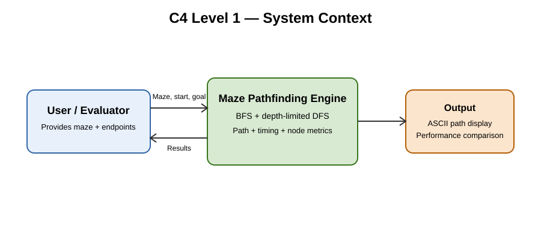
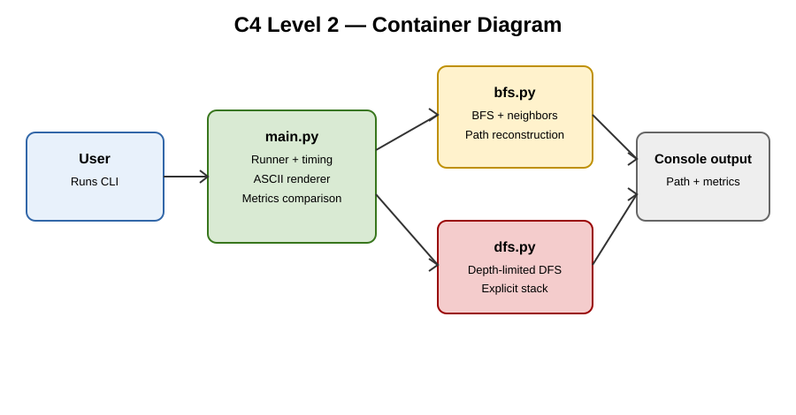
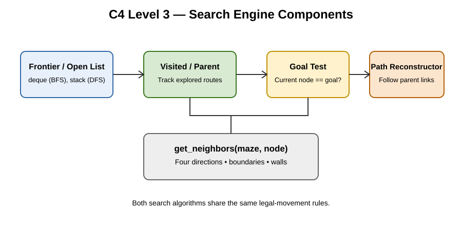
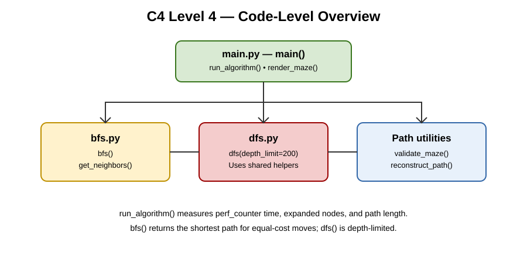

# SLE-3: Architectural Design — Full C4 Model

**Course:** 02AML204 – Introduction to Artificial Intelligence  
**System:** Grid-Based Maze Pathfinding Engine (BFS vs. DFS Solver)  
**Student:** Samruddhi Uddhavrao Patil  
**PRN:** 25UAM064 | **Division:** A

## 1. System overview
A command-line maze solver accepts a 2D grid, start and goal coordinates, and a DFS depth limit. It runs Breadth-First Search (BFS) and depth-limited Depth-First Search (DFS), then reports the path, elapsed time, expanded nodes, and path length.

## 2. Repository structure
- `main.py` — command-line runner, sample maze, timing, metrics, and ASCII rendering.
- `bfs.py` — shared grid-neighbor logic, validation, path reconstruction, and BFS.
- `dfs.py` — iterative depth-limited DFS.
- `diagrams/context.svg` — C4 Level 1 context diagram.
- `diagrams/container.svg` — C4 Level 2 container diagram.
- `diagrams/component.svg` — C4 Level 3 search-engine component diagram.
- `diagrams/code-level.svg` — C4 Level 4 code-level overview.
- `CONTRIBUTION_LOG.md` — project work log.

## 3. Architecture (C4)
### Level 1 — Context
The User/Evaluator supplies a maze, start/goal coordinates, and depth limit. The engine returns a visualized path and comparative performance metrics.



### Level 2 — Containers
The CLI runner coordinates execution; BFS and DFS modules perform search; the grid-neighbor helper validates legal four-direction moves; the runner renders the path and reports metrics.



### Level 3 — Components
The search engine uses a frontier (FIFO queue for BFS, LIFO stack for DFS), a visited/parent tracker, a goal test, and path reconstruction.



### Level 4 — Code-level overview
The main functions and their relationships are shown here.



## 4. Algorithms and design decisions
- **BFS:** uses `collections.deque` as a FIFO queue. For equal-cost moves, it finds a shortest path.
- **DFS:** uses an explicit LIFO stack and a configurable depth limit (default 200); it does not guarantee the shortest path.
- **Shared neighbor generator:** both algorithms use the same four-direction grid rules, making their movement constraints consistent.
- **Parent pointers:** reconstruct the route from goal back to start.
- **Timing:** `time.perf_counter()` measures elapsed wall-clock time. Results vary by machine and run.

## 5. Run the project
Requires Python 3.9 or later; no third-party packages are required.

```bash
python main.py
```

The program runs both algorithms on the included example maze and prints the path, elapsed time, expanded nodes, and path length. Path length is the number of moves (number of cells in the path minus one).

## 6. Output symbols
- `S` — start
- `G` — goal
- `#` — wall
- `.` — open cell
- `*` — cells on the returned path

## 7. Limitations
The sample maze is defined in `main.py`; edit it to test other grids. DFS is depth-limited and can fail to find a route if the goal is beyond the limit. Runtime comparisons should be repeated and treated as machine-dependent observations, not universal guarantees.

## 8. AI contribution note
AI assistance may be used for boilerplate, documentation formatting, and diagram structuring. Review the code, run tests, verify outputs, and disclose actual AI assistance according to course requirements.

## 9. Conclusion
The C4 model separates the system into user context, containers, search components, and code-level functions. This makes the maze solver easier to understand, test, and maintain.
